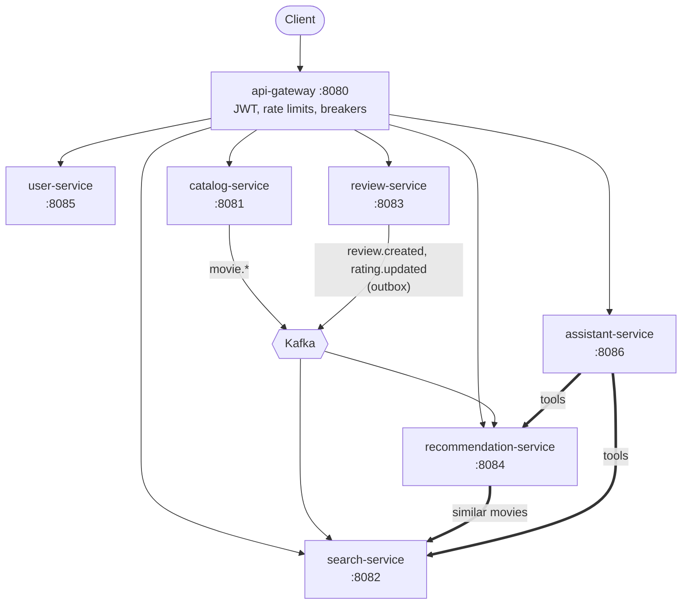

# movie-recommendation-system

[](https://github.com/advaitsane/movie-recommendation-system/actions/workflows/ci.yml)

MongoDB's `sample-app-java-mflix` monolith, rebuilt as six Spring Boot services behind a gateway,
then load-tested and broken on purpose. Kafka keeps the read models in sync, an outbox makes each
review and its event atomic, and circuit breakers turn a dead dependency into a degraded answer
instead of an outage. Every claim below links to the ADR, load-test result or chaos finding behind
it.


**Start here:** [the demo](docs/demo.md) (four acts, with dashboards and traces) ·
[the design review](docs/design-review.md) (consistency, failure modes, timeout budgets, what
breaks at 10x) · [the ADRs](docs/adr/README.md) (13 decisions, with their evidence)

## What this demonstrates

| Pattern | Where | Evidence |
|---|---|---|
| CQRS read model kept in sync by Kafka events | search-service keeps its own copy of the catalog, with text and vector indexes | [ADR-0002](docs/adr/0002-search-index-cqrs-kafka-sync.md): 1–2 s staleness |
| Transactional outbox | review-service writes each review and its event in one Postgres transaction | [ADR-0004](docs/adr/0004-outbox-pattern-review-service.md); events written during a Postgres outage were published after it ([ADR-0011](docs/adr/0011-chaos-testing.md) Updates 5–7) |
| Circuit breakers and graceful degradation | api-gateway per route; recommendation-service's call to search | [chaos run](chaos/results/02_service_kill_search-service_20261019T122356/FINDINGS.md): search killed, recommendations still 200, breaker closed about 15 s after recovery |
| Timeout budgets that nest | gateway → recommendation-service → search-service | [ADR-0010](docs/adr/0010-load-test-timeout-budget-mismatch.md): a mismatch failed 62.5% of recommendation requests under load |
| Load testing | k6 user journeys through the gateway | [`loadtest/`](loadtest/): p95 399 ms, p99 918 ms at 30 virtual users on a calm host ([ADR-0010](docs/adr/0010-load-test-timeout-budget-mismatch.md) Update 5) |
| Chaos engineering | dependency kill, service kill, network delay, memory starvation | [`chaos/`](chaos/) scripts and results; [ADR-0011](docs/adr/0011-chaos-testing.md): 4 experiments and 7 follow-up updates |
| Observability | OpenTelemetry traces in Jaeger; 3 Grafana dashboards provisioned as code | [ADR-0008](docs/adr/0008-observability-otel-prometheus-grafana.md); [screenshots in the demo](docs/demo.md#act-2-under-load) |
| Capacity sized from measurement | per-container memory limits; the stack fits an 8 GB laptop | [ADR-0010](docs/adr/0010-load-test-timeout-budget-mismatch.md) Updates 2, 3, 8, 9 |
| An LLM assistant that uses the system's own APIs as tools | assistant-service on Spring AI 2, streaming over SSE | [ADR-0013](docs/adr/0013-assistant-service-spring-ai-openai.md); [trace of a turn](docs/demo.md#act-4-the-assistant-v1) |

## Findings tests didn't catch

The services have unit and integration tests, most against real databases with Testcontainers in
CI. These still got through, and only load or a real outage showed them:

1. **The gateway's circuit breakers could never open.** `minimum-number-of-calls` was left at the
   library default of 100, in a window that holds 10 calls. Killing a service showed it
   ([ADR-0011 Update 4](docs/adr/0011-chaos-testing.md)).
2. **review-service's breaker passed 24 tests and never opened.** It sat inside a
   `@Transactional` method, whose proxy takes a database connection before the breaker runs, so
   during a Postgres outage every write still failed slowly with a raw 500
   ([ADR-0011 Update 6](docs/adr/0011-chaos-testing.md)).
3. **A health check said UP while its service failed most requests.** With Mongo stopped,
   catalog- and search-service failed 40–90% of requests and `/actuator/health` returned 200 the
   whole time, so an orchestrator would have kept sending them traffic
   ([ADR-0011 Experiment 1](docs/adr/0011-chaos-testing.md)).
4. **The timeout budgets didn't nest.** recommendation-service could spend 5 s on its search call
   inside a 4 s gateway route, so the gateway gave up just before the fallback answered
   ([ADR-0010](docs/adr/0010-load-test-timeout-budget-mismatch.md)). A second mismatch, three
   search calls in sequence, is still open; the
   [design review](docs/design-review.md#timeout-budget) has the fix.
5. **A cache race kept a stale list for 5 minutes.** A list computed between two rating events
   could be cached after the second event's eviction. Found while building the demo
   ([#31](https://github.com/advaitsane/movie-recommendation-system/pull/31)).

## Architecture



Each service owns its data: catalog and search use Mongo (with Atlas Search and vector indexes),
review, user and assistant use Postgres, and recommendation-service uses its own Mongo and Redis.
Thick arrows are the only synchronous calls between services. Everything reports to Jaeger and
Prometheus. The [design review](docs/design-review.md#architecture) has the full diagram,
including the stores and the observability stack.

## Quickstart

Requirements: Docker with at least 4 GB for its VM, `make`, and [k6](https://k6.io) for the load
and chaos tests.

```bash
make up     # build and start the stack; the first start loads the ~400 MB dataset (about 10 min)
make demo   # walk a new user from cold start to personal recommendations
make help   # load tests, chaos experiments, the assistant, teardown
```

Grafana is at http://localhost:3001 and Jaeger at http://localhost:16686. It all runs on an 8 GB
laptop, with little to spare: [running locally](docs/running-locally.md) covers the hardware
limits, each service, load and chaos testing, and secrets.

## Services

| Service | Port | Owns | Role |
|---|---|---|---|
| api-gateway | 8080 | — | Routes, checks JWTs, rate limits, one circuit breaker per route ([ADR-0007](docs/adr/0007-api-gateway-routing-and-deferred-discovery.md)) |
| catalog-service | 8081 | movies (Mongo) | Source of truth for the catalog; publishes `movie.*` events ([ADR-0001](docs/adr/0001-split-catalog-search-from-monolith.md)) |
| search-service | 8082 | its copy of the catalog (Mongo) | Keyword and vector search over a read model built from events ([ADR-0002](docs/adr/0002-search-index-cqrs-kafka-sync.md)) |
| review-service | 8083 | reviews and ratings (Postgres) | Writes reviews and their events through an outbox ([ADR-0003](docs/adr/0003-postgres-for-review-service.md), [ADR-0004](docs/adr/0004-outbox-pattern-review-service.md)) |
| recommendation-service | 8084 | ratings, profiles, movie metadata (Mongo), cache (Redis) | Blends a collaborative and a content signal; falls back to popularity ([ADR-0005](docs/adr/0005-recommendation-service-own-database-and-blend.md)) |
| user-service | 8085 | users (Postgres) | Registration and login; issues JWTs ([ADR-0006](docs/adr/0006-user-service-auth-and-activity-events.md)) |
| assistant-service | 8086 | conversations (Postgres) | LLM movie assistant that calls search and recommendations as tools ([ADR-0013](docs/adr/0013-assistant-service-spring-ai-openai.md)) |
| config-server | 8888 | — | Git-backed config; running, with no clients yet ([ADR-0009](docs/adr/0009-config-server.md)) |

Each service's README covers its API, and links a Postman collection with its error cases.
[`postman/full-demo.postman_collection.json`](postman/full-demo.postman_collection.json) runs the
whole demo flow through the gateway.

## How it was built

One build step per pull request, so the history shows how the system was built and why. Each PR
links the ADRs behind it.

| Step | Contents | Status |
|---|---|---|
| 0 | Repo scaffolding, infrastructure in docker-compose | ✅ |
| 1 | CI: build and test every service on each PR | ✅ |
| 2 | catalog-service and search-service (CQRS read model over Kafka) | ✅ |
| 3 | review-service (Postgres, outbox pattern) | ✅ |
| 4 | recommendation-service (content + collaborative blend, Redis cache) | ✅ |
| 5 | user-service (registration, JWT issuance, activity events) | ✅ |
| 6 | api-gateway (routing, JWT enforcement, rate limiting, circuit breakers) | ✅ |
| 7 | Observability (OpenTelemetry + Jaeger, Prometheus, Grafana) | ✅ |
| 8 | config-server (git-backed); Eureka left out by design | ✅ |
| 9 | Load testing (k6) and per-container memory limits | ✅ |
| 10 | Chaos testing and hardening | ✅ |
| 11 | assistant-service (LLM movie assistant with tool calling, Spring AI) | ✅ |
| 12 | One-command start, Grafana dashboards, a demo, a design review (#25–#32) | ✅ |

Known limitations and what comes next (evaluations for the assistant, then Kubernetes on EKS) are
in the [design review](docs/design-review.md#known-limitations).

## Repo layout

```
movie-recommendation-system/
├── Makefile            # make up / demo / smoke / load / chaos / down
├── docker-compose.yml
├── scripts/            # demo and helper scripts used by the Makefile
├── infra/              # config mounted into the containers, Grafana dashboards
├── loadtest/           # k6 load test and recorded results (ADR-0010)
├── chaos/              # fault-injection experiments and their findings (ADR-0011)
├── postman/            # end-to-end demo collection through api-gateway
├── services/           # one directory per service, each its own Maven project
└── docs/
    ├── demo.md
    ├── design-review.md
    ├── running-locally.md
    ├── adr/            # architecture decision records
    └── images/
```

## Credits

The starting point is MongoDB's
[`sample-app-java-mflix`](https://github.com/mongodb/sample-app-java-mflix) (Apache License 2.0)
and its `sample_mflix` dataset.

## License

[MIT](LICENSE)
