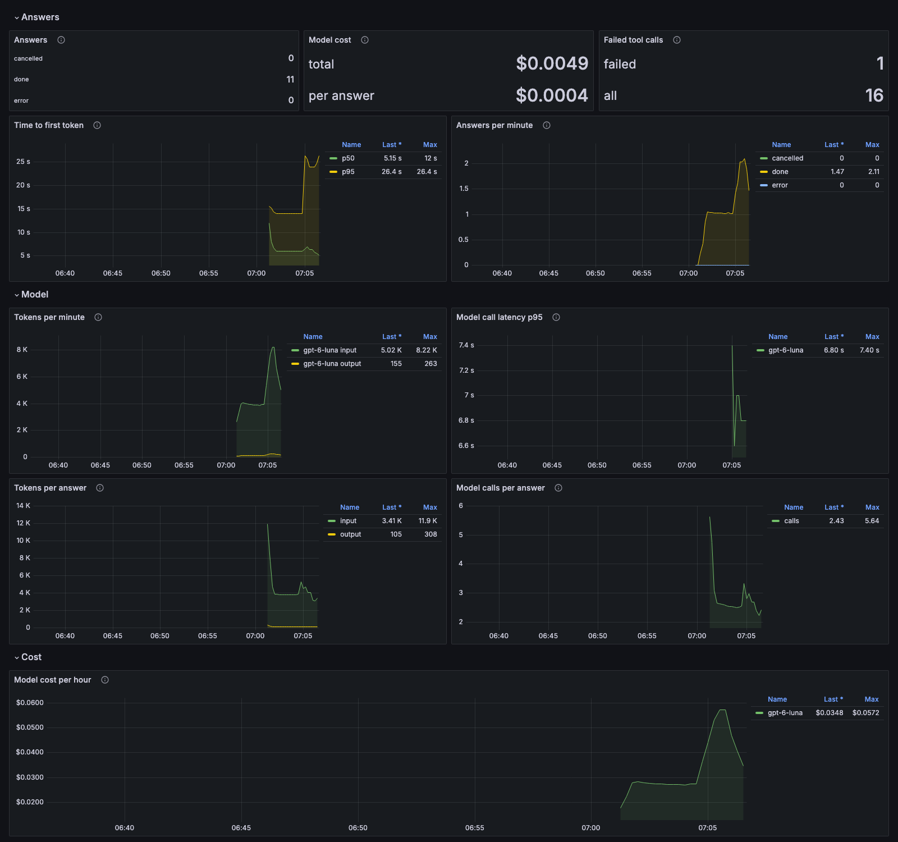

# Demo

The system in five acts, each with the command that runs it and the evidence it produces:

1. **A new user:** search, a review, and recommendations that turn personal once Kafka delivers
   the event.
2. **Under load:** k6 user journeys through the gateway, and the service that gives first.
3. **Break it:** search-service killed under traffic; the gateway fails fast, recommendations
   degrade instead of failing, and everything recovers on its own.
4. **The assistant:** an LLM that answers by calling this system's own APIs, and works around a
   slow one.
5. **Measuring the assistant:** 34 evals against the real model, a CI gate, and a dashboard for
   tokens and cost.

It all runs on an 8 GB laptop, so the latencies are laptop latencies. What the acts show is the
behavior: breakers opening, fallbacks counted, recovery. [Running it yourself](#running-it-yourself)
is at the end.

## Act 1: a new user, from cold start to personal

A new user goes from the most popular movies to recommendations of their own, a few seconds
after their first reviews.

```bash
make demo
```


`scripts/record-demo-gif.sh` re-records this GIF (asciinema and agg).

`make demo` seeds eight fans with recognizable tastes, then walks a new user through the
gateway:

1. **Register and log in.** user-service issues a JWT; the gateway checks it on every call.
2. **Search two ways.** "matrix" is a keyword search. "a hacker discovers reality is a
   simulation" is a vector search over plot embeddings, and finds The Matrix without the word.
   Both read search-service's own copy of the catalog, kept in sync by Kafka events (ADR-0002).
3. **Cold start.** With no ratings yet, recommendations are the movies most liked across all
   users (`POPULAR`).
4. **Review two movies.** 5 stars for The Matrix and Blade Runner. A second review of the same
   movie gets 409. review-service writes each review and its event in one Postgres transaction,
   and a poller publishes the event to Kafka (the outbox, ADR-0004).
5. **Recommendations turn personal**, a few seconds later, once both events reach
   recommendation-service. Each pick says which signal chose it (ADR-0005):
   - `CONTENT`: a plot similar to a movie you liked, from search-service's vectors;
   - `COLLABORATIVE`: liked by users whose tastes match yours;
   - `BOTH`.

   This is eventual consistency you can watch: the review is saved at once, and the
   recommendations catch up when the event arrives.

In Jaeger, a recommendation request shows where the time goes:


The gateway calls recommendation-service, which checks its Redis cache, then asks search-service
for movies similar to each of up to three liked movies. In this trace, taken before the fix, the
three calls run one after another, so a slow search-service slowed every recommendation three
times over. The assistant's evals later failed on the same thing, and the calls now run in
parallel under one 3 s deadline ([ADR-0010](adr/0010-load-test-timeout-budget-mismatch.md)).

## Act 2: under load

k6 drives real user journeys through the gateway, and the dashboards show which service gives
first.

```bash
make load VUS=5   # about 3 minutes, 5 virtual users per journey
```

Watch **Movies → Service overview (RED)**:


Request rate, error share and p50/p95/p99 per service. Search is the bottleneck:
the vector index pages in and out of memory, its latency climbs, and the gateway's search breaker
starts rejecting calls. The latency panels cap at 8s, the top histogram bucket, so the cold
warm-up shows as a flat line there. The design budget is 4 s per request; the local stack
allows 10 s, because vector search pages its index in from disk ([ADR-0010](adr/0010-load-test-timeout-budget-mismatch.md)).

## Act 3: break it

Kill a dependency while traffic is running: the system degrades instead of failing, and
recovers without help.

```bash
make chaos CHAOS="02_service_kill.sh search-service 30"
```

The script runs looping smoke traffic, kills search-service for 30 seconds, restarts it, and
records which services stayed healthy. Watch **Movies → Resilience**:


- The gateway's search breaker opens, and search requests fail fast with a 503 instead of
  waiting out the timeout.
- Recommendations keep answering 200: recommendation-service drops the content signal and counts
  each fallback as `search_unavailable`.
- When search-service is back, the breaker goes half-open, lets a few calls through, and closes.

ADR-0011 records what the four chaos experiments found, including three gaps that tests alone
hadn't caught. To show the gateway failing fast on a slow dependency rather than a dead one, use
the latency experiment instead; it needs a delay longer than the local 10s budget:
`make chaos CHAOS="03_network_fault.sh delay search-service 12000 30"`.

## Act 4: the assistant

An LLM answers movie questions by calling this system's own APIs as tools, and a slow tool
costs it a step, not the answer.

```bash
OPENAI_API_KEY=... make assistant   # adds assistant-service to the running stack
make demo                            # now ends with one streamed answer
```

The answer streams over server-sent events. In Jaeger, one turn shows every model call and tool
call:


Reading it top to bottom:
1. The gateway checks the user's rate limit in Redis (`evalsha`).
2. The model searches for The Matrix (`searchMovies`).
3. It asks for similar movies (`findSimilarMovies`). search-service took 8.8 s here, and the
   tool's 6 s timeout fired: the red marks.
4. The model recovers by searching by description instead (`findMoviesByDescription`, a vector
   search, including search-service's call to the embedding API), then writes the answer.

A failing tool doesn't fail the answer: Spring AI sends the tool's error ("search is unavailable
right now") back to the model as its result, and the model picks another way (ADR-0013). One slow
dependency costs a step, not the whole answer.

A demo shows one answer. Act 5 shows how all of them are measured.

## Act 5: measuring the assistant

34 evals run the real model against the real catalog, on every pull request that touches the
assistant, for about a cent and a half a run.

The assistant's tests run against a stub of the OpenAI API, so they can't say whether an answer is
any good. The evals send 34 real requests to the real model and check each recommended movie
against the catalog: that it exists, and that it matches the request's year, genre and rating
([`evals/`](../evals/), [ADR-0014](adr/0014-assistant-evals.md)).

```bash
make eval-up        # only what the assistant's tools reach, about 2.2 GB (after one `make up`)
make eval-metrics   # adds Prometheus and Grafana for the dashboard below
make eval           # 34 scenarios, about 3 minutes and $0.015 on gpt-6-luna
```

Each scenario prints its verdict and, when it fails, the check that failed. From the CI run on
[#44](https://github.com/advaitsane/movie-recommendation-system/pull/44), trimmed:

```text
PASS  f-90s-comedies-7                7.7s  tools=3
PASS  f-romcom-2000-2004              5.6s  tools=3
PASS  d-first-contact                 3.5s  tools=1
PASS  s-like-inception                5.3s  tools=2
PASS  p-scifi-fan                     2.1s  tools=1
PASS  x-code                          0.9s  tools=0
  "passed": 34,
  "pass_rate": 1.0,
  "grounding_rate": 1.0,
  "constraint_rate": 1.0,
  "cost_usd": 0.0152,
```

- **Grounding 100%:** every movie the model recommended exists in the catalog.
- **`d-first-contact`** failed in three of five CI gates before this one (#38, #42, #43): the
  model left out the genre filter it has, and vector search returned a documentary among the
  sci-fi. The saved tool calls showed the pattern: 6 of 8 runs sent the genre, and those 6
  passed. The tool description's example was almost word for word this scenario's request, so
  the test had been grading a request the model was shown. A neutral example and a rule to send
  the genre whenever a request implies one fixed it: 12 of 12, then 34 of 34 on this run
  ([ADR-0014](adr/0014-assistant-evals.md)).
- **`x-code`** asks for a Python function. The model used to write one; a prompt rule stopped it,
  and this scenario keeps it stopped.

The same run is a [CI gate](../.github/workflows/assistant-evals.yml) on every pull request that
touches the assistant, its tools' services or the evals. It fails under 91% and puts the pass
rate and failed checks on the run's page. The README lists
[what the evals caught](../README.md#what-the-evals-caught).

In Grafana, the **Assistant (LLM)** dashboard shows the run as it happens:



- **Time to first token:** about 5 s at p50. Tool calls come first, so this is most of the wait.
- **Tokens per answer:** about 3,400 in, 105 out. Every model call resends the system prompt,
  the history and the tool results, and an answer makes 2.4 calls on average.
- **Cost:** tokens times list prices kept in Prometheus rules, about $0.0004 an answer.
- **Failed tool calls:** the 1 here is recommendation-service stopped on purpose. Spring AI's own
  metric records that call as a success ([ADR-0008](adr/0008-observability-otel-prometheus-grafana.md)).

Next: a grounding check inside the service, so an invented title never reaches the user, and an
LLM judge for what the catalog can't check, whether a movie fits the request.

## Running it yourself

Every command runs from the repo root; [running locally](running-locally.md) covers setup. On an
8 GB laptop with a 4 GB Docker VM, start from fresh data and restart once, so the first start's
index rebuild doesn't leave the VM swapping ([ADR-0010](adr/0010-load-test-timeout-budget-mismatch.md)):

```bash
make clean && make up   # first start: about 10 minutes
make down && make up    # about a minute
```

Grafana is at http://localhost:3001 (no login needed) and Jaeger at http://localhost:16686.
