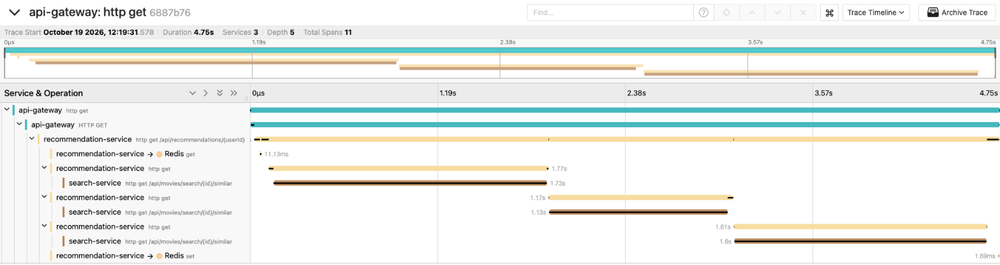
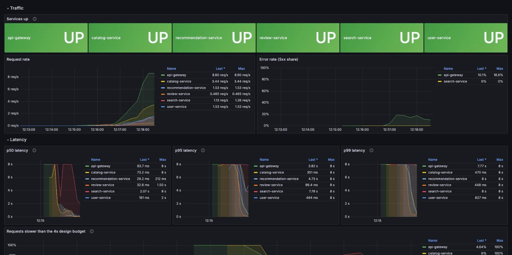
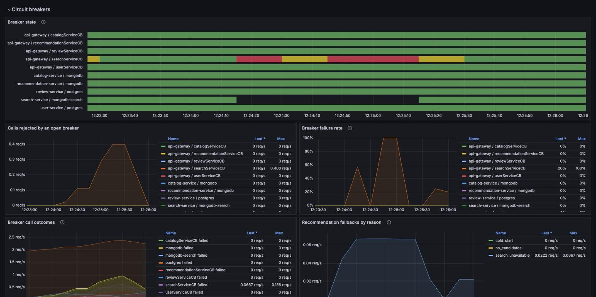
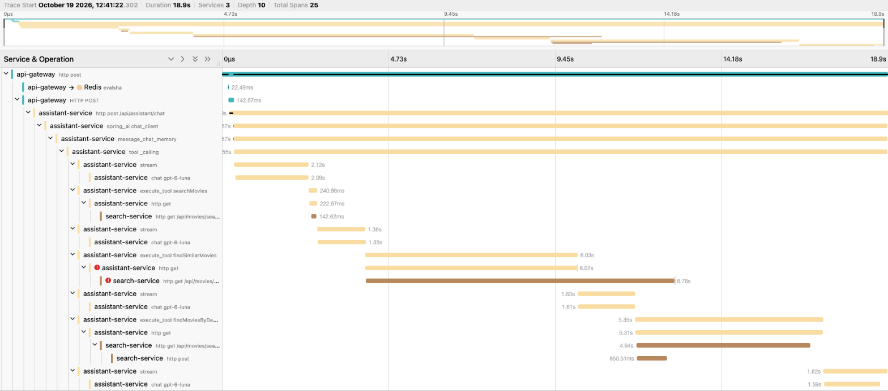

# Demo

A walk through the system in four acts: a new user's happy path, the system under load, a
dependency failing, and the AI assistant. It's also the script for the demo video. Every command
runs from the repo root on a laptop; [running locally](running-locally.md) covers setup.

On an 8 GB laptop with a 4 GB Docker VM, start from fresh data and restart once, so the first
start's index rebuild doesn't leave the VM swapping (ADR-0010 Update 10):

```bash
make clean && make up   # first start: about 10 minutes
make down && make up    # about a minute
```

Open Grafana at http://localhost:3001 (no login needed) and Jaeger at http://localhost:16686.

## Act 1: a new user, from cold start to personal

```bash
make demo
```


`make demo` seeds eight fans with recognizable tastes, then walks a new user through the
gateway:

1. **Register and log in.** user-service issues a JWT; the gateway checks it on every call.
2. **Search two ways.** "matrix" is a keyword search. "a hacker discovers reality is a
   simulation" is a vector search over plot embeddings, and finds The Matrix without the word.
   Both read search-service's own copy of the catalog, kept in sync by Kafka events (ADR-0002).
3. **Cold start.** With no ratings yet, recommendations are the movies most liked across all
   users (`POPULAR`).
4. **Review two movies.** 5 stars for The Matrix and Blade Runner. A second review of the same
   movie gets 409. review-service writes each review and its event in one Postgres transaction,
   and a poller publishes the event to Kafka (the outbox, ADR-0004).
5. **Recommendations turn personal**, a few seconds later, once both events reach
   recommendation-service. Each pick says which signal chose it (ADR-0005):
   - `CONTENT`: a plot similar to a movie you liked, from search-service's vectors;
   - `COLLABORATIVE`: liked by users whose tastes match yours;
   - `BOTH`.

   This is eventual consistency you can watch: the review is saved at once, and the
   recommendations catch up when the event arrives.

In Jaeger, a recommendation request shows where the time goes:



The gateway calls recommendation-service, which checks its Redis cache, then asks search-service
for movies similar to each of up to three liked movies, one after another. The three calls are
sequential, so a slow search-service slows every recommendation three times over. That's a
finding this trace makes obvious: ADR-0010 Update 9 records it, and the fix (one deadline for the
search signal, or parallel calls) is next.

## Act 2: under load

```bash
make load VUS=5   # about 3 minutes, 5 virtual users per journey
```

Watch **Movies → Service overview (RED)**:



Request rate, error share and p50/p95/p99 per service. On this laptop, search is the bottleneck:
the vector index pages in and out of memory, its latency climbs, and the gateway's search breaker
starts rejecting calls. The latency panels cap at 8s, the top histogram bucket, so the cold
warm-up shows as a flat line there. These are laptop numbers: the design budget is 4s per
request, and the local stack allows 10s (ADR-0010 Update 9).

## Act 3: break it

```bash
make chaos CHAOS="02_service_kill.sh search-service 30"
```

The script runs looping smoke traffic, kills search-service for 30 seconds, restarts it, and
records which services stayed healthy. Watch **Movies → Resilience**:



- The gateway's search breaker opens, and search requests fail fast with a 503 instead of
  waiting out the timeout.
- Recommendations keep answering 200: recommendation-service drops the content signal and counts
  each fallback as `search_unavailable`.
- When search-service is back, the breaker goes half-open, lets a few calls through, and closes.

ADR-0011 records what the four chaos experiments found, including three gaps that tests alone
hadn't caught. To show the gateway failing fast on a slow dependency rather than a dead one, use
the latency experiment instead; it needs a delay longer than the local 10s budget:
`make chaos CHAOS="03_network_fault.sh delay search-service 12000 30"`.

## Act 4: the assistant (v1)

```bash
OPENAI_API_KEY=... make assistant   # adds assistant-service to the running stack
make demo                            # now ends with one streamed answer
```

The assistant answers over server-sent events. To answer, the model calls this system's own
search and recommendation APIs as tools. In Jaeger, one turn shows every model call and tool call:



Reading it top to bottom:
1. The gateway checks the user's rate limit in Redis (`evalsha`).
2. The model searches for The Matrix (`searchMovies`).
3. It asks for similar movies (`findSimilarMovies`). On this laptop, search-service took 8.8s,
   and the tool's 6s timeout fired: the red marks.
4. The model recovers by searching by description instead (`findMoviesByDescription`, a vector
   search, including search-service's call to the embedding API), then writes the answer.

A failing tool doesn't fail the answer: Spring AI sends the tool's error ("search is unavailable
right now") back to the model as its result, and the model picks another way (ADR-0013). One slow
dependency costs a step, not the whole answer.

This is v1: evaluations and a grounding check come next (roadmap Phase 2).
