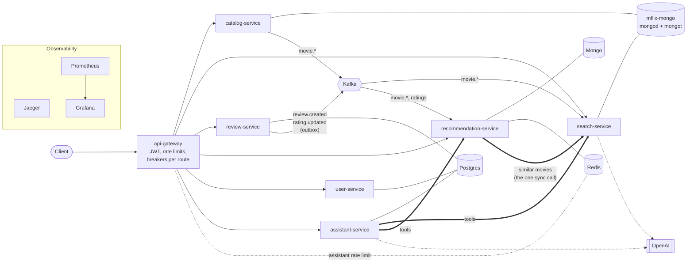
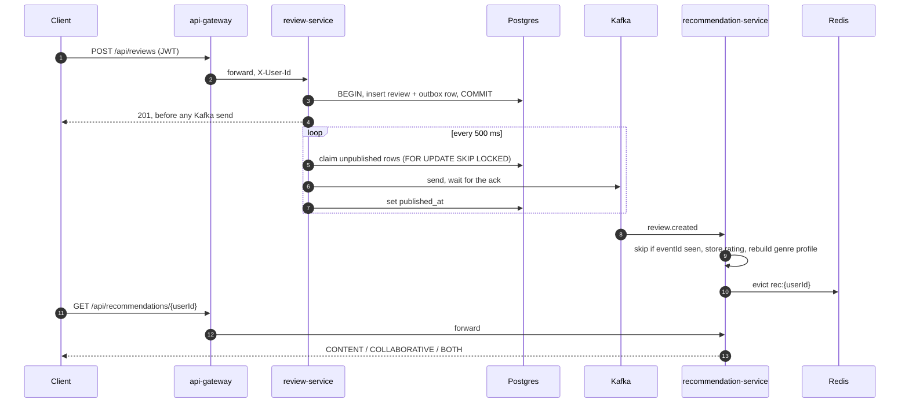
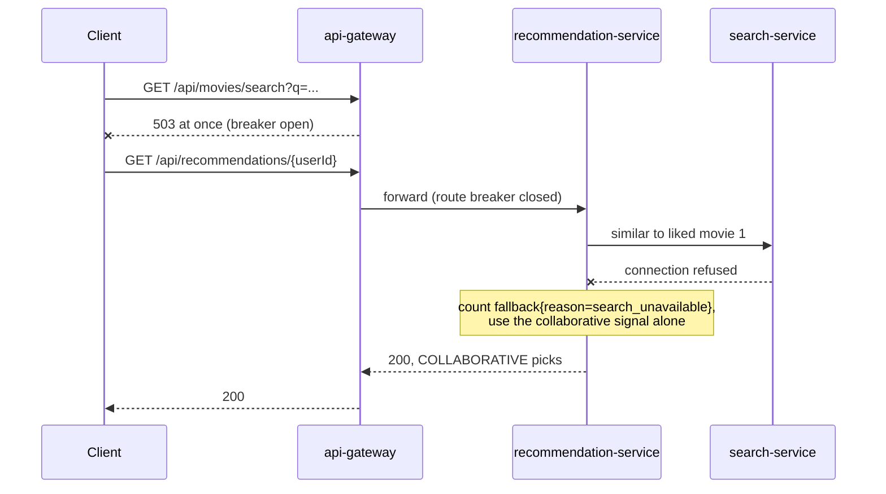
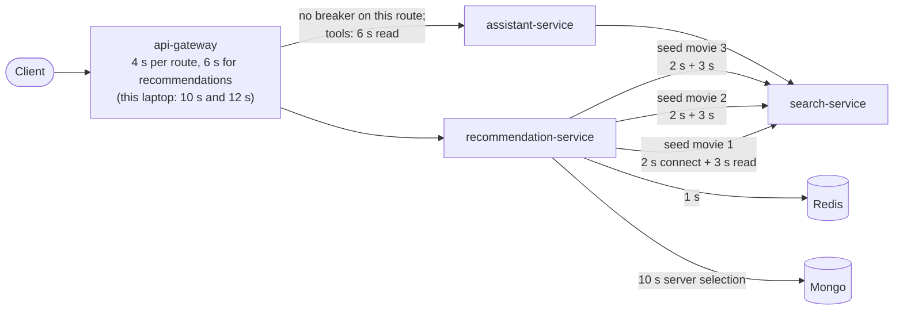

# Design review

This document reviews the system as it stands: how data stays consistent, what happens when each
part fails, where the timeouts sit, what breaks first under more load, and what I'd change. Every
claim links to the ADR or recorded result it comes from. Where something hasn't been tested, the
document says so.

[The demo](demo.md) shows the system running; [the ADRs](adr/README.md) hold the full reasoning.

## Context and goals

The starting point is MongoDB's `sample-app-java-mflix`, one Spring Boot service. It is now six
services behind a gateway, each owning its data ([ADR-0001](adr/0001-split-catalog-search-from-monolith.md)).
The goal is not a production movie site. It is to practice the parts of distributed systems that
go wrong in production, and to check each one with load tests and chaos experiments rather than
assume it works:

- read models kept in sync by events, and the staleness that comes with them;
- a write and its event committed together (the outbox);
- timeouts, circuit breakers and fallbacks that keep a slow dependency from spreading;
- enough metrics and traces to see all of the above.

Non-goals: multiple instances of a service, a hosted deployment, and recommendation quality.
Kubernetes on EKS comes in a later phase of the roadmap.

## Architecture

Thick arrows are synchronous calls between services. Every service sends traces to Jaeger and is
scraped by Prometheus ([ADR-0008](adr/0008-observability-otel-prometheus-grafana.md)).

Some choices that shape everything below:
- **search-service keeps its own copy of the catalog** (`movies_search`), built from catalog's
  events, with the text and vector indexes on that copy
  ([ADR-0002](adr/0002-search-index-cqrs-kafka-sync.md)).
- **recommendation-service keeps three read models** (movie metadata, ratings, per-user genre
  profiles), all built from events. Its one synchronous call is to search-service, for movies
  with a similar plot ([ADR-0005](adr/0005-recommendation-service-own-database-and-blend.md)).
- **review-service writes each review and its event in one Postgres transaction**; a poller
  relays the events to Kafka ([ADR-0004](adr/0004-outbox-pattern-review-service.md)).
- **The gateway is the only place that checks a JWT.** It forwards the user id as `X-User-Id` and
  strips any copy the client sent ([ADR-0007](adr/0007-api-gateway-routing-and-deferred-discovery.md),
  [ADR-0012](adr/0012-oauth2-oidc-migration-path.md)).
- **assistant-service is separate,** so an LLM outage can't take recommendations down. It calls
  search and recommendations as read-only tools ([ADR-0013](adr/0013-assistant-service-spring-ai-openai.md)).

## Consistency model, per flow

| Flow | Mechanism | Guarantee | Staleness, measured | Known gaps |
|---|---|---|---|---|
| catalog → search's copy | Kafka `movie.*`; startup backfill over REST | at-least-once while Kafka is up | 1–2 s ([ADR-0002](adr/0002-search-index-cqrs-kafka-sync.md)) | catalog publishes fire-and-forget, so an event lost in a Kafka outage is never resent (see below) |
| catalog → recommendation's metadata | Kafka `movie.*`; backfill when it holds fewer movies than catalog | same | not measured | the backfill never removes a movie ([ADR-0005](adr/0005-recommendation-service-own-database-and-blend.md)) |
| review → recommendation | outbox, 500 ms poll, consumer dedupes by `eventId` | at-least-once, never a review without its event | about 5 s ([ADR-0005](adr/0005-recommendation-service-own-database-and-blend.md)); 2–5 s in the demo | deleting a review, or editing only its text, publishes no event ([ADR-0004](adr/0004-outbox-pattern-review-service.md)) |
| user activity | direct publish to `user.activity` | lossy by choice | — | nothing consumes it yet ([ADR-0006](adr/0006-user-service-auth-and-activity-events.md)) |
| recommendation cache | Redis cache-aside, 5 min TTL, evicted on each rating event | a list computed before a rating is never cached after it | — | fixed in [#31](https://github.com/advaitsane/movie-recommendation-system/pull/31), see below |
| assistant conversations | Postgres, owner checked per turn | each turn sees the stored history | — | two tabs on one conversation can interleave turns ([ADR-0013](adr/0013-assistant-service-spring-ai-openai.md)) |

The flow from a review to a personal recommendation is the one the demo shows:

Three findings about consistency that tests alone didn't show:

1. **The cache could keep a stale list for 5 minutes.** Two ratings arrive as two events. A request
   that computed its list between them could write that list to Redis after the second event's
   eviction, so the movie the user had just rated stayed recommended. The fix records the newest
   rating time the list was built from and caches it only if no newer rating has arrived
   ([#31](https://github.com/advaitsane/movie-recommendation-system/pull/31)).
2. **A timeout in front of a write is ambiguous.** On a cold stack the gateway answered 503 to a
   registration that still committed; the retry got 409. The API has no idempotency keys, so a
   client can't tell "failed" from "slow" ([ADR-0010 Update 10](adr/0010-load-test-timeout-budget-mismatch.md)).
3. **Profiles built before the metadata arrived never heal.** A rating of a movie
   recommendation-service doesn't know yet adds no genres to the profile, and nothing rebuilds the
   profile later, so that user gets no collaborative peers until their next rating
   ([ADR-0010 Update 10](adr/0010-load-test-timeout-budget-mismatch.md)).

## Failure modes

What happens when each dependency goes down or slows down, from the chaos experiments
([ADR-0011](adr/0011-chaos-testing.md)) unless noted.

| Fault | What the system does | Evidence |
|---|---|---|
| mflix-mongo stopped | catalog and search return errors; their health turns 503, so a probe would pull them; the other services stay healthy; clean recovery | Experiment 1 and Update 1; rerun in [ADR-0010 Update 6](adr/0010-load-test-timeout-budget-mismatch.md) |
| search-service killed | the gateway's search breaker opens and search fails fast with 503; recommendations keep answering 200 without the content signal (`search_unavailable`); the breaker closes about 15 s after search is back | Experiment 2; [2026-10-19 rerun](../chaos/results/02_service_kill_search-service_20261019T122356/FINDINGS.md) |
| search-service 8 s slower | recommendations come back in about 6 s, bounded by the timeout, and degrade | Experiment 3 |
| search-service out of memory | recommendations degrade; the killed container stays down until restarted, since the app services have no restart policy | Experiment 4 |
| any service down, behind the gateway | after 5 failed calls the route's breaker opens and fails in about 10 ms. **Before the fix the breakers never opened**: `minimum-number-of-calls` defaulted to 100 against a window of 10 | Update 4 |
| recommendation-service's Mongo stopped | each call fails after 10 s until the breaker opens after 4–5 calls; before the fix, 15 s each and 30 s to report DOWN | Update 3 |
| Redis stopped | recommendations still 200, about 2 s slower (read and write each time out at 1 s); the assistant's rate limit fails open | Update 3; [ADR-0007](adr/0007-api-gateway-routing-and-deferred-discovery.md) update |
| Postgres stopped | user and review-service report DOWN in 3 s, the breaker opens after 5 calls, then a clean 503. **review-service's breaker first never opened**: it sat inside a `@Transactional` method, whose proxy takes a connection before the breaker runs. Outbox rows written during the outage were published after it | Updates 5–7 |
| OpenAI slow or failing | only the assistant is affected. A failing tool goes back to the model as its result, and the model tries another way | [ADR-0013](adr/0013-assistant-service-spring-ai-openai.md); [demo act 4](demo.md#act-4-the-assistant-v1) |
| Docker VM out of memory | before memory limits, the kernel killed whichever JVM it picked; now each service is sized from measurement | [ADR-0010 Updates 2, 3, 8](adr/0010-load-test-timeout-budget-mismatch.md) |
| **Kafka stopped** | **not tested yet.** By design, reviews still commit and wait in the outbox (the `review.outbox.unpublished` gauge shows the backlog). Catalog writes also succeed, but their events are dropped, so search's copy and recommendation's metadata drift until a later event touches the same movie | design, from [ADR-0004](adr/0004-outbox-pattern-review-service.md) and [ADR-0006](adr/0006-user-service-auth-and-activity-events.md); next chaos experiment |

When search-service is down, a recommendation degrades rather than fails:

Two patterns came up more than once. A breaker that compiles and passes its tests can still never
open: it happened at the gateway (a library default) and in review- and user-service (the breaker
inside the transaction). Only a real outage showed it. And a health check that answered 200 while
its service failed most requests (mflix-mongo, Experiment 1) would have kept an orchestrator
sending traffic to it.

## Timeout budget

An inner budget has to be shorter than the outer one, or the caller gives up before the fallback
can answer. Load testing found this twice:

1. **Recommendations had 5 s inside a 4 s route.** One search call could take 2 s to connect plus
   3 s to read, so the gateway returned 503 while recommendation-service was about to return its
   fallback. 62.5% of recommendation requests failed at 30 virtual users. The route got 6 s
   ([ADR-0010](adr/0010-load-test-timeout-budget-mismatch.md)).
2. **6 s covers one call, but there are three.** A recommendation asks for movies similar to each of
   up to three liked movies, one after another, so the worst case is 15 s. With a slow
   search-service, recommendations took 6.7–9.2 s and the gateway gave up again. The Jaeger trace
   in [demo act 1](demo.md#act-1-a-new-user-from-cold-start-to-personal) shows the three calls in
   sequence ([ADR-0010 Update 9](adr/0010-load-test-timeout-budget-mismatch.md)). **Not fixed
   yet**: the fix is one deadline for the whole search signal, with the three calls made in
   parallel.

The assistant route has no breaker: a time limiter bounds the whole response, and a healthy stream
runs past the 4 s limit. assistant-service reports failures inside the stream, and
caps tool calls at 3 per tool and 6 per answer after a model looped on a timed-out tool
([ADR-0013](adr/0013-assistant-service-spring-ai-openai.md)).

## Running on an 8 GB laptop

All of this runs on an 8 GB Intel Mac with a 3.82 GiB Docker VM, and the stack needs about
3.85 GB with every service on ([ADR-0010 Update 9](adr/0010-load-test-timeout-budget-mismatch.md)).
The services are sized from measurement, not guessed: search-service's heap was cut to 35% of its
limit after Native Memory Tracking showed the heap mostly empty and the rest of the process
starved ([Update 8](adr/0010-load-test-timeout-budget-mismatch.md)). To fit:

- assistant-service and config-server are off by default (`make assistant`, `make up-all`);
- the gateway timeouts are settings: 4 s and 6 s in `application.yml`, 10 s and 12 s in compose,
  because vector search pages its index in from disk. `GATEWAY_TIMEOUT=4s
  GATEWAY_RECOMMENDATION_TIMEOUT=6s make up` restores the design budget on a bigger host.

So latency measured here is laptop latency, not evidence for the 4 s budget. On a calm host the
full load test (30 virtual users) passed its latency budget: p95 399 ms, p99 918 ms
([Update 5](adr/0010-load-test-timeout-budget-mismatch.md)). Behavior is what the laptop shows
reliably: breakers opening, fallbacks counted, recovery.

## What breaks first at 10x and 100x

| Part | Today | What breaks | The fix |
|---|---|---|---|
| mflix-mongo | mongod and mongot (Atlas Search) in one container, shared by catalog and search | already the bottleneck at 30 users: 100–270% CPU, search paths failing while catalog reads stayed healthy ([ADR-0010](adr/0010-load-test-timeout-budget-mismatch.md)) | split search's database from catalog's, then dedicated search nodes |
| Recommendation fan-out | up to 3 sequential search calls per cache miss | latency is 3× search latency; at 10x, cache misses multiply the load on search | one deadline, parallel calls; at 100x, compute lists when a rating arrives rather than per request |
| Gateway rate limit | one 50 req/s bucket, in memory, shared by every client | at 10x the gateway rejects ordinary traffic; each instance has its own bucket | per-client limits in Redis, as the assistant route already does |
| Kafka | one broker; every topic 1 partition, replication factor 1 (checked live) | one consumer per group, and losing the broker loses events | partitions keyed by movie or user id, replication factor 3 |
| Cold start and popularity | grouped in memory over every liked rating ([ADR-0005](adr/0005-recommendation-service-own-database-and-blend.md)) | each cold-start request reads all ratings; at 100x this dominates | a popularity counter kept up to date by the rating consumer |
| Service addresses | a configured URL per service, one instance each ([ADR-0007](adr/0007-api-gateway-routing-and-deferred-discovery.md)) | a second instance needs discovery everywhere at once | Kubernetes Service DNS |
| Tokens | HS256 with a secret shared by the gateway and user-service | every new validator gets the signing key | OIDC provider and JWKS ([ADR-0012](adr/0012-oauth2-oidc-migration-path.md)) |
| Embeddings | one OpenAI call per movie write and per vector query | provider rate limits (429); failed embeddings are repaired every 15 min ([ADR-0002](adr/0002-search-index-cqrs-kafka-sync.md)) | batch, and cache query embeddings |

## What I'd change

In order:

1. **One deadline for the search signal**, with the calls in parallel. It's the open budget finding
   above, and it holds on any host.
2. **Catalog events through an outbox,** like reviews. Fire-and-forget made sense while a missed
   event healed on the next one, but nothing re-syncs the read models after a Kafka outage. Then
   run the Kafka chaos experiment.
3. **Idempotency keys on writes,** so a client can retry after a timeout safely.
4. **Delete events for reviews,** and a job that rebuilds profiles built without metadata.
5. **Better collaborative peers.** Users are compared only by genre weights
   ([ADR-0005](adr/0005-recommendation-service-own-database-and-blend.md)), so two fans of
   different sci-fi films count as the same taste. Comparing the movies they rated would fix that.
6. **One error format.** The gateway's own errors are JSON, but its 429 has an empty body
   ([ADR-0007](adr/0007-api-gateway-routing-and-deferred-discovery.md)), and a pool error once leaked
   Hikari's message in a 500
   ([ADR-0011 Update 5](adr/0011-chaos-testing.md)). RFC 9457 `ProblemDetail` everywhere.
7. **config-server: adopt it or retire it.** It runs, but no service reads from it
   ([ADR-0009](adr/0009-config-server.md)). On Kubernetes, ConfigMaps make it redundant.
8. **Jackson 3 in every service** before Spring Boot 4.3 removes Jackson 2 support
   ([ADR-0013](adr/0013-assistant-service-spring-ai-openai.md)).

## Known limitations

These are known and documented, not fixed yet:

- **No dynamic service discovery.** Every call between services uses a configured URL, which is
  enough at one instance per service ([ADR-0007](adr/0007-api-gateway-routing-and-deferred-discovery.md)).
- **A caller that bypasses the gateway is trusted.** The activity endpoint rejects an `X-User-Id`
  that doesn't match its path, but a direct call sends no header. Network policy on Kubernetes,
  letting only the gateway reach the services, closes it ([ADR-0006](adr/0006-user-service-auth-and-activity-events.md),
  [ADR-0011 Update 5](adr/0011-chaos-testing.md)).
- **Self-issued HS256 JWTs** with a shared secret ([ADR-0012](adr/0012-oauth2-oidc-migration-path.md)).
- **config-server has no clients** ([ADR-0009](adr/0009-config-server.md)).
- **The app services have no restart policy in compose,** so an OOM-killed service stays down
  ([ADR-0011](adr/0011-chaos-testing.md), Experiment 4).
- **review-service: a connection lost in the middle of a transaction** is a different failure from
  pool exhaustion, and its breaker doesn't cover it ([ADR-0011 Update 6](adr/0011-chaos-testing.md)).
- **The assistant's OpenAI calls appear as separate traces** in Jaeger, not under the chat span:
  the OpenAI SDK uses its own HTTP client ([ADR-0013](adr/0013-assistant-service-spring-ai-openai.md)).

## Roadmap

- **The assistant, phase 2:** evals scored against the catalog, a CI gate at 91% on gpt-6-luna
  (32–34 of 34 in the last three runs), and a Grafana dashboard for tokens, cost, time to first
  token and tool failures are done ([ADR-0014](adr/0014-assistant-evals.md),
  [ADR-0008 Update 3](adr/0008-observability-otel-prometheus-grafana.md)). Next come an LLM judge
  for relevance, calibrated against hand labels, then a check inside the service that answers
  only name movies the tools returned. gpt-6.1-sol can't call tools through Chat Completions, so
  the quality baseline on it waits for a Responses API client
  ([ADR-0014 Update 1](adr/0014-assistant-evals.md)).
- **Kubernetes:** Helm charts, a local `kind` cluster, then EKS with Terraform. That gives the
  design budget real headroom, probes for the health checks above, and network policy for the
  gateway bypass.
- **An incident copilot** that diagnoses this system's chaos experiments from its metrics, traces
  and ADRs, scored against the recorded findings.
